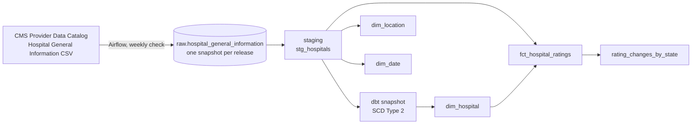

# Hospital Quality Warehouse with Airflow and dbt

An open-source warehouse that tracks how U.S. hospitals' type, ownership and CMS star ratings change from one release to the next, and answers which states had the most hospitals gain or lose a star.

**Stack:** Apache Airflow · dbt Core · PostgreSQL · Python · Docker Compose · GitHub Actions

## Results

> **Real-data results:** _load at least two CMS releases and fill in: hospitals, versions created, dbt tests passing, and the top states by stars lost from `marts.rating_changes_by_state`._

On three synthetic releases, the full pipeline (load → dbt snapshot per release → star schema → 16 dbt tests) passes end to end in CI and locally:

| Check | Result |
| --- | --- |
| Hospitals tracked | 122 (120 + 2 that opened in the third release) |
| Current versions | 119 (3 hospitals closed in the third release) |
| History starts | at the first release date, not the load time |
| Fact rows | 359, every one linked to the hospital version valid on its release date |
| dbt tests | 16 passed: keys, relationships, accepted ratings, no overlapping SCD windows, fact grain |

## Architecture



### Star schema

| Table | Grain | Key columns |
| --- | --- | --- |
| `dim_hospital` | One row per **version** of a hospital (SCD Type 2) | `hospital_key`, `facility_id`, type, ownership, rating, `valid_from`, `valid_to`, `is_current` |
| `dim_location` | One row per state / county / city / ZIP | `location_key` |
| `dim_date` | One row per CMS release | `date_key` |
| `fct_hospital_ratings` | One row per hospital per release | `hospital_key`, `location_key`, `date_key`, `overall_rating` |
| `rating_changes_by_state` | One row per state per pair of consecutive releases | stars gained, lost, unchanged |

## How the SCD Type 2 history works

- Each CMS release is loaded as a snapshot with its release date. Reloading a date replaces it.
- `dbt snapshot` compares the release with the current version of each hospital. When the name, type, ownership, rating or emergency services change, the old version is closed and a new one opens.
- `updated_at` is set to the release date, so a change is dated to the release that showed it, even when old releases are backfilled later.
- Hospitals missing from a release are closed (`invalidate_hard_deletes`).
- The fact table joins each release to the hospital version valid on that date, so past ratings always point to the hospital as it was then.

## Run it

```bash
docker compose up -d   # Postgres + Airflow; UI at http://localhost:8080
```

The `hospital_quality` DAG checks CMS every Monday. When a release URL hasn't been loaded before, it loads it, snapshots it, rebuilds the marts and runs the tests; otherwise it skips.

Without Airflow:

```bash
pip install -r requirements.txt
python scripts/make_sample_data.py --out sample_data          # or download real releases
PYTHONPATH=src python -m hqw.pipeline --csv-dir sample_data     # backfill releases in date order
PYTHONPATH=src python -m hqw.pipeline --download --snapshot-date 2026-11-06
cd dbt && dbt docs generate --profiles-dir . && dbt docs serve --profiles-dir .   # lineage graph
```

Connection settings come from `WAREHOUSE_HOST`, `WAREHOUSE_PORT`, `WAREHOUSE_USER`, `WAREHOUSE_PASSWORD` and `WAREHOUSE_DB`.

**Tests:** `pytest`. With `WAREHOUSE_HOST` set, it also runs the full backfill against Postgres and checks the SCD history; CI does this with a Postgres service.

## Design decisions

- **Raw is append-by-release, staging is clean, marts are modeled.** Raw keeps every release exactly as loaded, so the snapshot history can always be rebuilt.
- **"Not Available" ratings become NULL**, not zero, and are excluded from star comparisons.
- **Columns are matched by name, not position.** CMS headers are normalized (`City/Town` → `city_town`) and required columns are checked, so a layout change fails loudly instead of loading shifted data.
- **Idempotent DAG.** It skips releases it has already loaded, so retries and manual re-runs are safe.
- **Tests encode the model's promises:** unique keys, valid relationships, ratings 1–5, no overlapping validity windows, one current version per open hospital, one fact row per hospital per release.

## Limitations

- When a hospital closes, its last version is closed at the time the snapshot runs, not on the release date.
- To start with real history, you need several past releases; check which ones CMS still offers.

## Data source

[CMS Hospital General Information](https://catalog.data.gov/dataset/hospital-general-information), Centers for Medicare & Medicaid Services, U.S. government data. The sample files in `scripts/make_sample_data.py` are synthetic.
