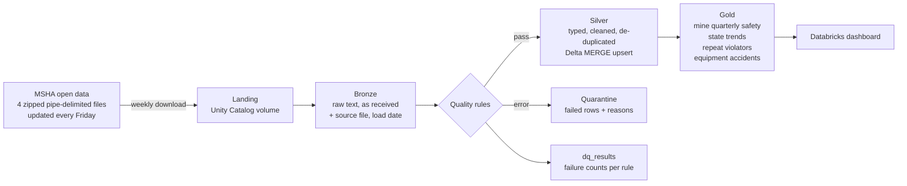

# Mine Safety Lakehouse

A weekly lakehouse pipeline on Databricks that turns raw U.S. mine safety records into clean, trusted tables and a safety dashboard.

It loads four public datasets from the U.S. Mine Safety and Health Administration (MSHA): mines, inspections, violations and accidents. It runs them through a bronze, silver and gold (medallion) architecture with incremental loads and automated data quality checks.

**Stack:** Python · PySpark · Delta Lake · Databricks (Free Edition) · Unity Catalog · Databricks Asset Bundles · pytest · GitHub Actions

## Results

Tested end to end on two weekly batches of [synthetic sample data](#sample-data), which have the same file layout as MSHA's real files:

| Table | Week 1 loaded | Week 2: new | Week 2: changed | Week 2: unchanged | Quarantined per batch |
| --- | --- | --- | --- | --- | --- |
| silver_mines | 400 | 15 | 12 | 388 | 1 |
| silver_inspections | 3,168 | 97 | 0 | 3,168 | 6 |
| silver_violations | 11,130 | 259 | 25 | 11,105 | 5 |
| silver_accidents | 699 | 23 | 0 | 699 | 2 |

- **Incremental:** week 2 wrote only new and changed records, such as 12 mines that changed operator and 25 penalties that were paid. Unchanged records were not rewritten.
- **Re-runnable:** running the same week again inserts and updates nothing, and bronze skips a batch it has already loaded.
- **Nothing lost silently:** every one of the 14 bad records per batch was caught by a quality rule and kept in a quarantine table, with the reason it failed.

> **Real-data results:** _run the pipeline on Databricks and replace this line with your real row counts, run time and data quality numbers._

## Architecture



| Layer | What it holds | How it's written |
| --- | --- | --- |
| Bronze | Every column as raw text, plus `_source_file`, `_load_date`, `_ingested_at` | Appended once per load date |
| Silver | Typed and cleaned records, one row per key, plus a `_row_hash` | Delta `MERGE`: inserts new keys, updates only rows whose hash changed |
| Quarantine | Rows that failed an error rule, with the rule names | Replaced per load date |
| Gold | Business tables for analysis | Rebuilt from silver each run |

## Data quality

Rules live in [`src/lakehouse/quality.py`](src/lakehouse/quality.py). An **error** rule sends a row to quarantine; a **warn** rule loads the row and counts the problem in `dq_results`.

| Dataset | Error rules | Warning rules |
| --- | --- | --- |
| Mines | missing or malformed mine ID, negative employees | malformed state, non-numeric numbers |
| Inspections | missing event number, mine ID or begin date; end date before begin date; begin date in the future | malformed dates |
| Violations | missing violation number, mine ID or date; date in the future; negative penalty | S&S flag not Y/N; mine not in the mines table |
| Accidents | missing document number, mine ID or date; date in the future; negative injuries or days lost | missing narrative; mine not in the mines table |

The pipeline also restores mine IDs that lost their leading zeros (`4608` → `0004608`) and stops with a clear error if MSHA renames a column the pipeline depends on.

## Gold tables

- **gold_mine_quarterly_safety:** per mine and quarter: inspections, violations, significant and substantial (S&S) violations, proposed penalties, accidents, injuries and days lost.
- **gold_state_safety_trends:** yearly totals by state, mine type and coal vs metal/non-metal, with injuries per 100 employees.
- **gold_repeat_violators:** mines with S&S violations in at least 3 of the last 4 quarters, ranked.
- **gold_equipment_accidents:** accidents by equipment and accident type, with the share that were fatal or caused permanent disability.

The dashboard queries are in [`sql/dashboard_queries.sql`](sql/dashboard_queries.sql).

## Run it

### On Databricks (real MSHA data)

1. Sign up for [Databricks Free Edition](https://docs.databricks.com/aws/en/getting-started/free-edition).
2. In your workspace, create a Git folder from this repository.
3. Open `notebooks/run_pipeline.py` and run all cells. It creates the `workspace.mine_safety` schema and a `landing` volume, downloads the four MSHA files and builds every table.
4. Build a dashboard from the queries in `sql/dashboard_queries.sql`.
5. Optional: deploy the weekly schedule with the [Databricks CLI](https://docs.databricks.com/aws/en/dev-tools/cli/): set your workspace URL in `databricks.yml`, then run `databricks bundle deploy`.

### Locally (sample data, no Databricks needed)

Needs Python 3.10+ and Java 17+.

```bash
pip install -r requirements-dev.txt
python scripts/make_sample_data.py --out sample_data
PYTHONPATH=src python -m lakehouse.pipeline --mode local \
    --source-dir sample_data/2026-10-30 --load-date 2026-10-30
PYTHONPATH=src python -m lakehouse.pipeline --mode local \
    --source-dir sample_data/2026-11-06 --load-date 2026-11-06
pytest
```

Locally, tables are written as Parquet through `ParquetStore`, which applies the same upsert logic as the Delta `MERGE`. CI runs the full test suite twice: once with Parquet and once with real Delta Lake tables.

## Sample data

[`scripts/make_sample_data.py`](scripts/make_sample_data.py) generates **synthetic** files with MSHA's exact headers and file format. They are not real mine records. The script deliberately adds the problems real data has, so the quality rules have something to catch: missing IDs, malformed and future dates, negative amounts, duplicate rows, IDs that lost their leading zeros, and records pointing to mines that don't exist. The second weekly batch changes some records and adds new ones to exercise the incremental logic.

## Design decisions

- **Bronze keeps everything as text.** Converting types at read time would silently turn bad values into nulls. Converting in silver lets the pipeline count and report every value it could not convert.
- **Change detection with a row hash.** MSHA republishes full files every week. Comparing a hash of each row's content means a MERGE only rewrites records that actually changed, and the run reports exactly how many were new, changed or unchanged.
- **Quarantine instead of drop.** Bad rows go to a table with the reason they failed, so they can be investigated and reprocessed. Nothing disappears without a record.
- **Errors vs warnings.** Rows that would corrupt analysis (no key, impossible dates, negative money) are quarantined. Rows with a minor problem (an unknown flag, a mine not in the current extract) are loaded but counted.
- **Gold is rebuilt, silver is incremental.** Silver is the large, deduplicated source of truth and is updated incrementally. Gold is small, so rebuilding it fully each run keeps it simple and always consistent.
- **Safe under ANSI SQL mode.** Databricks serverless runs Spark in ANSI mode, where a bad date or number crashes `to_date` or `CAST`. The pipeline uses `try_to_timestamp` and `try_cast` so bad values become nulls that the quality checks report.

## Limitations and next steps

- Injuries per 100 employees uses each mine's **current** employee count, so it is approximate for past years. MSHA's quarterly Employment/Production dataset has hours worked per period and would give true incident rates.
- Records deleted from MSHA's files stay in silver. Tracking deletions would need a soft-delete flag on keys missing from a full snapshot.
- Gold rebuilds fully each run, which would become slow at much larger scale; incremental gold aggregation is the next step there.

## Data source

[MSHA Open Government Data](https://arlweb.msha.gov/OpenGovernmentData/OGIMSHA.asp): U.S. Department of Labor, public domain. Field definitions are in each dataset's definition file on that page.
